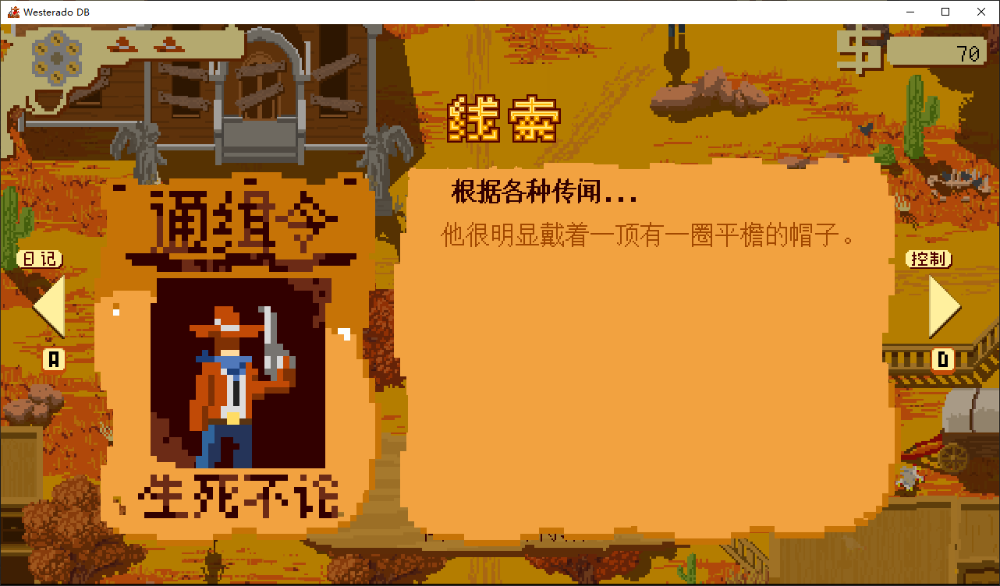
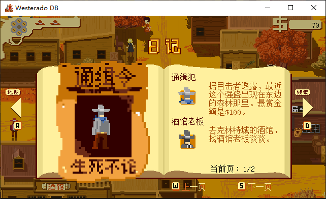
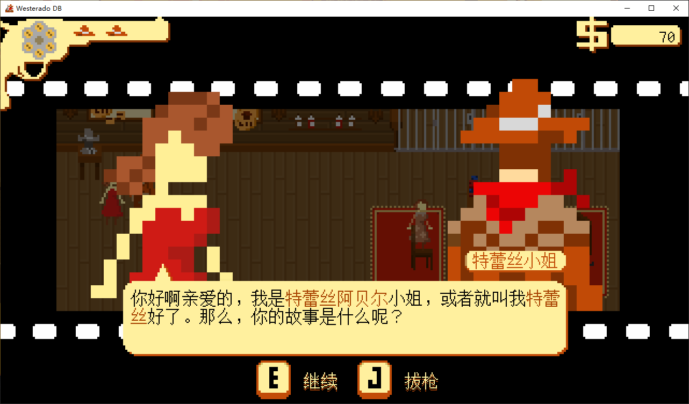
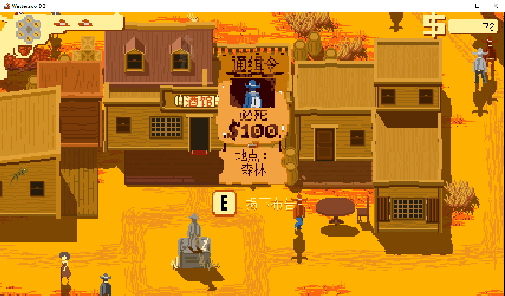
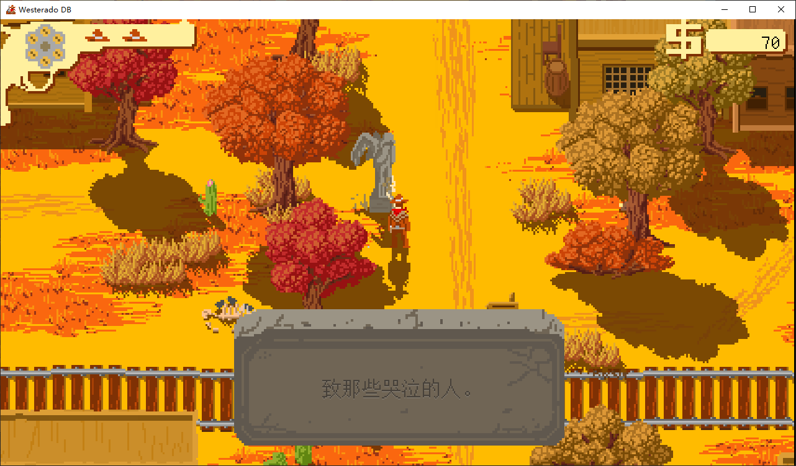
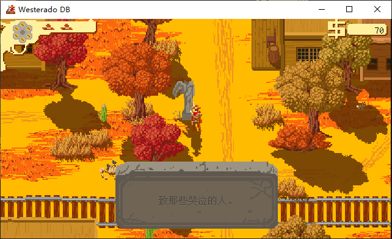
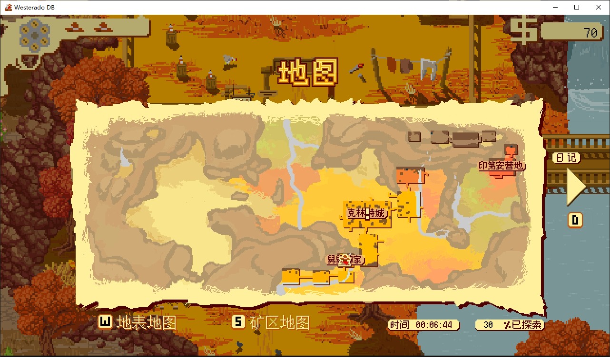
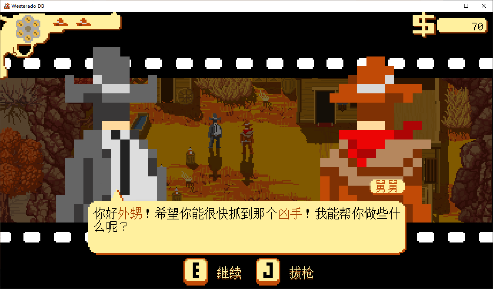
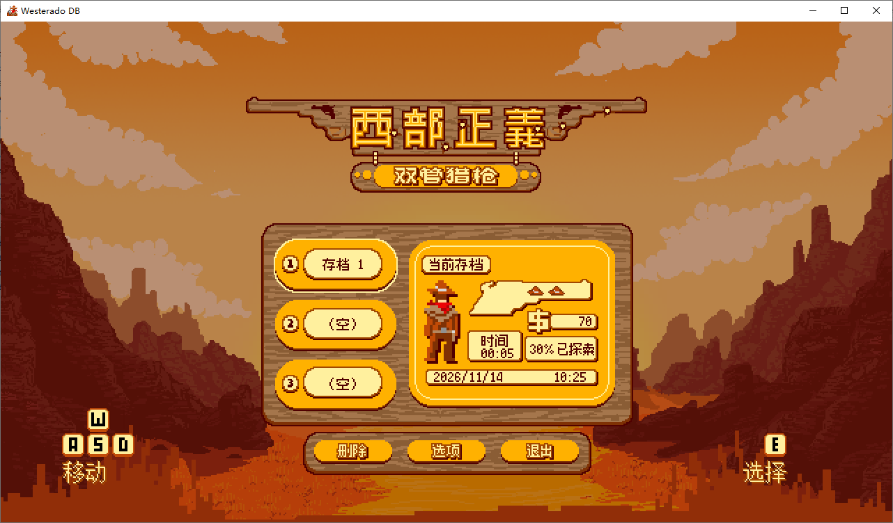

# Westerado_Double_Barreled_cn
steam游戏《西部正义：双管猎枪》汉化补丁by涉川良  
本补丁首发于贴吧。github上是备用链接。

# 注意事项
请各位兄弟们下载补丁后，解压里面的exe文件在游戏根目录下运行。
如果失败了，或者打补丁之后游戏出现问题，可能原因有：
1. 这个补丁我是用.net制作的，我已经打包了运行时。  
  如果无法运行，先在这里提交issue，或者发邮件到ensb@foxmail.com,不用去下载庞大的.net运行时。  
2. 补丁需要最新版的游戏原文件，请在steam上购买后下载最新版游戏（截至20261016之前的最新版）。  
  如果没有这些文件，补丁是不会运行的。  
3. 如果你使用过其他汉化补丁或者移除、修改了原版文件，请恢复英文原版文件，否则无法安装补丁。  
4. ！！！！！！【一定要看，非常重要】！！！！！！  
由于汉化已经改变了非常多的数据，因此，汉化后的游戏已经**不能**使用英文原版/其他汉化版的存档，  
**例如任务名称和简介会保留原版或其他汉化版的内容。**  
因此，请**重新开档**进行游戏。  

# 本补丁特色
+ 我是flash网页版的汉化者，当年的demo汉化就是我做的。
+ 全部译文和技术内容都是人工过关，特别是译文，每一行我都是亲自人工校对并润色过的（虽然还是存在少量失误，请看文末）。
+ 我使用了免费AI进行了初翻和工具粗制作。感谢千问。
+ 图片都是我手工汉化的。精心修改，图片、文字风格与原版对齐，原汁原味。
+ 使用了unifont16px像素字体和缝合像素字体10px。感谢这些开源字体！
+ 牌桌加入作弊功能：在换牌阶段，翻到牌背之后，按j可以只换牌但不结束换牌阶段。建议做同花，概率高。
+ 粤语：鸵匪阿伦说的是粤语（原版是荷兰语？），导演说的是带粤语发音的普通话（原版也是英语夹杂其他语言）。demo中我也是这么翻译的。
+ 对话某些名词显示为棕色。游戏的文本显示底层是我修改过的，以后还会更新这些名词的显示效果。
+ 其他内容请到西部正义贴吧查看我发的贴子。

# 截图

# 目前存在的问题
+ 迷茫的矿工对话中人名会变为英文。
+ 杂货店女店员的对话有漏翻。  
### **我还在收集bug。下一个更新将修补以上内容。**

# MOD计划
将来可能更新mod内容。敬请期待。
